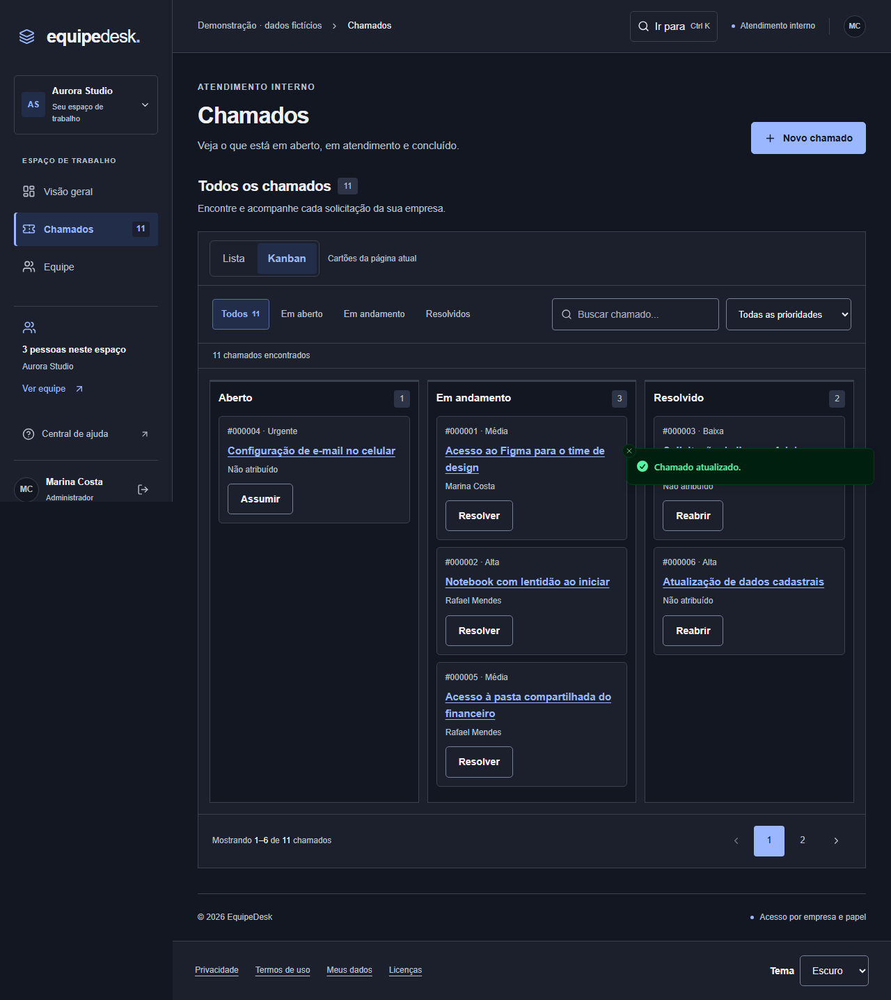
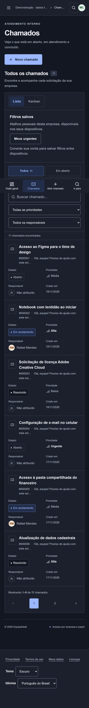
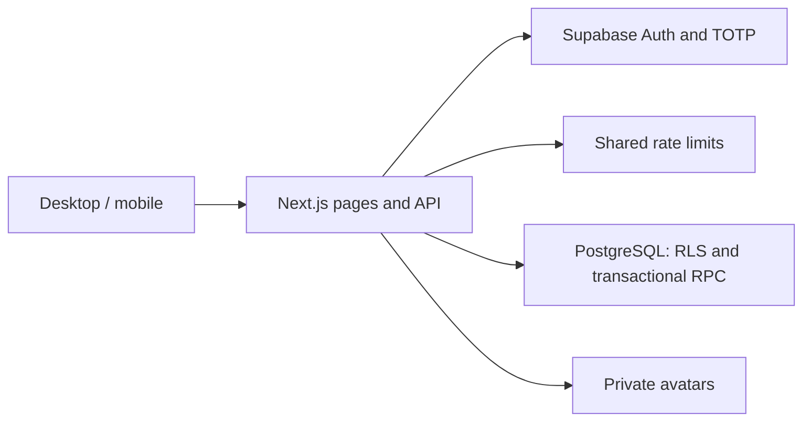

# EquipeDesk

[Português do Brasil](README.md)

EquipeDesk organizes internal support into isolated workspaces. Teams can assign, prioritize and track requests through a list or Kanban board, with an audit trail and an interface available in Brazilian Portuguese and English on desktop and mobile.



<details><summary>Mobile interface</summary>



</details>

[Watch the automated demo](artifacts/equipedesk-demo.webm) — three minutes, with Portuguese captions and fictional data.

## Try it

[Published application](https://miakaelsondesk.vercel.app). The hosted application uses real authentication. To explore without credentials, run locally and choose **Conhecer a demonstração** (Explore the demo) on the login screen. Demo data is fictional and kept in memory. Features in this branch may still be in staging.

## Stack

| Layer                   | Technology                                         |
| ----------------------- | -------------------------------------------------- |
| Application             | Next.js 16 App Router, React 19, strict TypeScript |
| Interface               | Tailwind CSS 4, Radix UI, light/dark themes        |
| Identity and storage    | Supabase Auth, PostgreSQL RLS, private Storage     |
| Distributed rate limits | Upstash Redis REST                                 |
| Verification            | Vitest, Playwright, SQL tests, GitHub Actions      |
| Hosting                 | Vercel                                             |

## Run locally

Requires Node.js 24 and pnpm 11.25.0. In a fresh clone without configured Supabase environment variables:

```sh
pnpm install --frozen-lockfile
pnpm test
pnpm dev
```

Open http://localhost:3000 and select the demo. For persistent storage, see [.env.example](.env.example) and the [technical documentation](docs/README.md). Never configure administrative keys in the web process.

## Architecture



## Technical decisions

- RLS enforces workspace and role boundaries in the database, not only in the UI.
- Transactional RPC keeps authorization, changes and history in one transaction.
- Ticket versions reject stale writes instead of silently overwriting concurrent changes.
- Redis shares atomic counters across serverless instances.
- The isolated demo reuses pure transition rules; production retains PostgreSQL authorization and persistence.
- Administrative TOTP raises sessions to AAL2 at protected application boundaries. Recovery is performed separately by an authorized operator.

[Verification and limitations](docs/validacao-atual.md) · [Decision guide](docs/decisoes-tecnicas.md) · [Historical records](docs/historico.md)

Next steps: resolve the outstanding dependency advisory, validate transactional email delivery and external alerts, then add bulk actions, notifications and explicit SLA policies. Technical documentation is currently in Portuguese.
