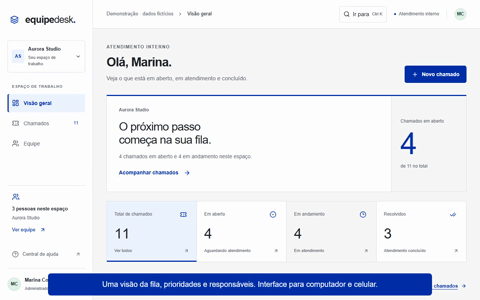
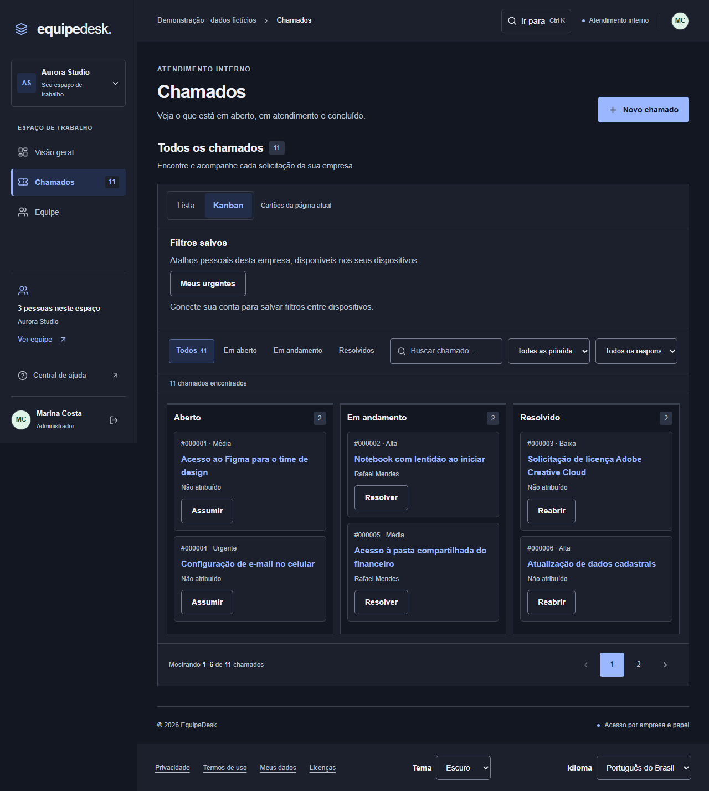
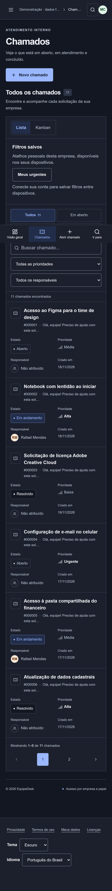
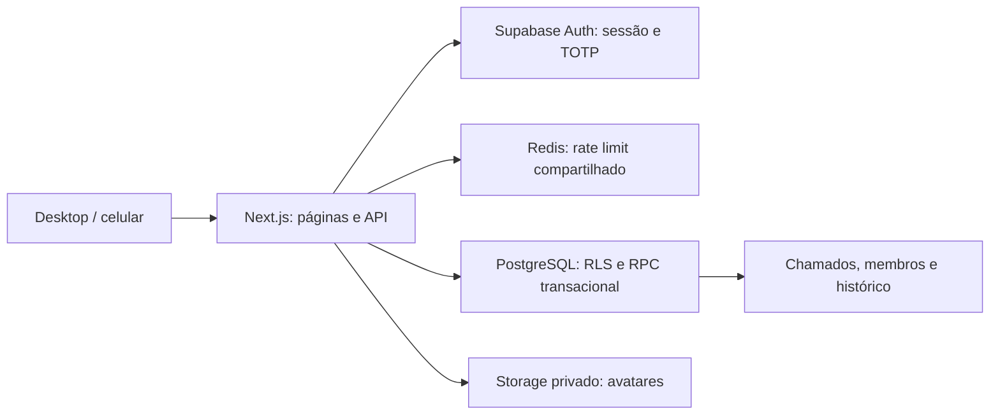

# EquipeDesk

[](https://github.com/kaua-chavesvk/equipedesk/actions/workflows/ci.yml) · [MIT](LICENSE)

[English](README.en.md)

EquipeDesk organiza o atendimento interno de equipes em espaços de trabalho isolados: cada solicitação tem responsável, prioridade e histórico, desde a abertura até a resolução. A interface funciona em português e inglês, no computador e no celular, com fila em lista ou Kanban.





<details>
<summary>Veja a interface no celular</summary>



</details>

[Assista à demonstração automatizada de 3 minutos](artifacts/equipedesk-demo.webm) — com legendas técnicas e dados fictícios.

## Experimente

[Site publicado](https://miakaelsondesk.vercel.app) · [Código e evolução](https://github.com/kaua-chavesvk/equipedesk/pulls)

O site publicado usa autenticação real. Para explorar sem credenciais, rode a demonstração local e clique em **Conhecer a demonstração** na tela de login. Ela usa dados fictícios em memória; não envia e-mails nem representa persistência de produção. As imagens acima registram essa demonstração. Recursos desta branch podem ainda estar em homologação.

## Stack

| Camada               | Tecnologia                                          |
| -------------------- | --------------------------------------------------- |
| Aplicação            | Next.js 16 App Router, React 19, TypeScript estrito |
| Interface            | Tailwind CSS 4, Radix UI, temas claro/escuro        |
| Identidade e dados   | Supabase Auth, PostgreSQL, RLS e Storage privado    |
| Limites distribuídos | Upstash Redis REST                                  |
| Qualidade            | Vitest, Playwright, testes SQL, GitHub Actions      |
| Hospedagem           | Vercel                                              |

## Rodar em três comandos

Pré-requisitos: Node.js 24 e pnpm 11.25.0. No diretório do repositório clonado, em uma instalação nova sem `.env.local` configurado:

```sh
pnpm install --frozen-lockfile
pnpm test
pnpm dev
```

Abra http://localhost:3000 e clique em **Conhecer a demonstração**. Sem configuração Supabase, o desenvolvimento usa a demonstração. Para persistência real, consulte [.env.example](.env.example) e a [documentação](docs/README.md); nunca coloque chaves administrativas no processo web.

## Arquitetura



## Decisões técnicas

- **RLS por empresa e papel:** o isolamento dos dados é verificado no banco, além dos controles da interface. Um solicitante acessa seus chamados; atendentes e administradores têm permissões diferentes.
- **RPC transacional:** `desk_command` reúne autorização, alteração e evento na mesma transação. Uma falha não deve deixar um chamado alterado sem seu registro correspondente.
- **Concorrência explícita:** cada chamado tem `version`. A atualização envia a versão lida; uma disputa rejeita a escrita desatualizada, em vez de sobrescrever silenciosamente o trabalho de outra pessoa.
- **Rate limit distribuído:** instâncias serverless compartilham contadores no Redis. O login combina limites por IP e identidade derivada do e-mail, com proteção agregada adicional.
- **Demonstração isolada:** dados fictícios em memória permitem explorar a experiência; as transições reutilizam as regras puras de domínio. A produção continua usando autorização e transações no PostgreSQL.
- **MFA administrativo:** TOTP eleva a sessão para AAL2 nos pontos administrativos protegidos. A recuperação é uma operação administrativa separada; não há chave privilegiada no servidor web.

Veja [como explicar e verificar essas decisões](docs/decisoes-tecnicas.md).

## Qualidade e próximos passos

Os resultados atuais e seus limites ficam em [validação](docs/validacao-atual.md), evitando totais divergentes no README. O histórico de execuções anteriores permanece identificado como histórico.

- Resolver o alerta de dependência registrado na auditoria antes da liberação do pacote em produção.
- Configurar e validar entrega transacional de e-mails e alertas externos.
- Evoluir ações em lote, notificações e indicadores de SLA com regras de prazo explícitas.

[Documentação técnica](docs/README.md) · [Histórico](docs/historico.md) · [Roteiro para apresentação de 2–3 minutos](docs/apresentacao.md)

[Changelog](CHANGELOG.md) · [MIT](LICENSE)
