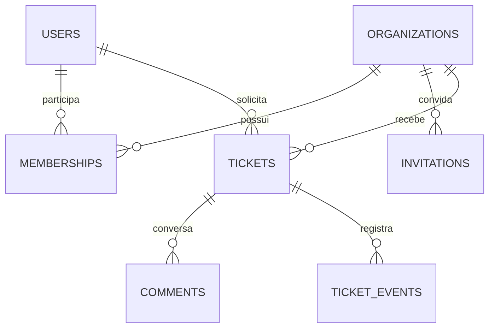

# Arquitetura e autorização

Next.js App Router mantém a leitura inicial em componentes de servidor e as interações em componentes de cliente. Route Handlers validam entradas com Zod, resolvem sessão e associação pelo slug e retornam erros em português. O cliente SSR oficial do Supabase mantém a sessão em cookie. Dados privados não usam cache compartilhado.

Comentários e eventos possuem chave estrangeira composta com empresa e chamado. Remover associação não remove identidade nem histórico. Índices iniciam pela empresa e suportam estado e ordenação estável por data e UUID.

| Capacidade | Solicitante | Atendente | Administrador |
|---|---|---|---|
| Abrir chamado | Sim | Sim | Sim |
| Ler e comentar | Próprios | Fila da empresa | Fila da empresa |
| Assumir e resolver | Não | Sim | Sim |
| Reabrir com motivo | Próprios | Fila da empresa | Fila da empresa |
| Gerenciar equipe e convites | Não | Não | Sim |

RLS protege leitura direta com credenciais de usuário. Escrita acontece por funções transacionais com contexto de autenticação; o cliente não altera empresa, autor, versão ou papel por atualização direta. A função confirma acesso antes de expor existência do recurso. Versão condicional resolve concorrência de atendimento. A empresa é bloqueada durante alterações de membros para serializar a proteção do último administrador.

O modo de demonstração sem credenciais é uma simulação para explorar a interface. Ele não constitui evidência de RLS nem substitui execução dos testes no PostgreSQL. A verificação de segurança real exige Supabase configurado e credenciais de usuário, sem chave privilegiada no fluxo normal.

Referências de implementação: [autenticação no Next.js](https://nextjs.org/docs/app/guides/authentication), [RLS no Supabase](https://supabase.com/docs/guides/database/postgres/row-level-security), [projetos no Playwright](https://playwright.dev/docs/test-projects).
