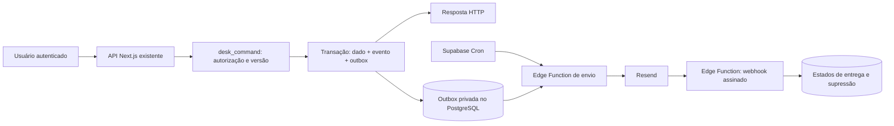

# Integração de e-mail — desenho para aprovação

**Fase 2 · 16/11/2026 · status: proposta pronta para revisão, implementação não iniciada.**

Base: [descoberta](descoberta-integracao.md), commit `d4a6bd4`. O usuário autorizou seguir pelo caminho recomendado de saída transacional primeiro. A aprovação deste desenho, exigida antes da Fase 3, ainda está pendente. Todos os endpoints, campos, funções e tabelas novos descritos abaixo são contratos propostos, não funcionalidades existentes.

## 1. Objetivo, escopo e aceite

Entregar e-mails operacionais de acesso e atendimento em português, com isolamento por empresa, controle de duplicação, registro de falhas e resposta rápida às ações do usuário. Provedor de referência: **Resend**, sujeito à disponibilidade de domínio próprio, revisão de custo/volume e contratação autorizada. Nenhuma conta paga, domínio ou credencial foi criado nesta fase.

Incluído na primeira entrega:

1. Verificação de confirmação de cadastro e recuperação de senha pelo Supabase Auth com SMTP próprio, em homologação.
2. Envio de convite de participação em empresa, preservando o token de uso único e as regras atuais.
3. Avisos de chamado criado, nova resposta e chamado resolvido.
4. Outbox durável, worker, idempotência, eventos de entrega, supressão, diagnóstico e desligamento por empresa.

Recebimento de e-mails como chamados, respostas convertidas em comentários, anexos, marketing, importação de caixas e sincronização Gmail/Microsoft 365 ficam para desenho posterior. A mensagem orientará a responder no painel; não anunciará resposta por e-mail. Não haverá caixa de recebimento implícita no endereço remetente.

Critérios de sucesso propostos para o piloto:

- Uma ação autorizada gera no máximo um trabalho por evento/destinatário, incluindo retries da mesma intenção HTTP.
- Provedor indisponível não provoca perda de uma ação já confirmada no banco; a mensagem fica pendente ou falha de forma visível à operação.
- Em condições normais de homologação, primeira tentativa em até dois minutos após o commit. Essa é uma meta a medir, não um SLA já contratado.
- Nenhum envio para outra empresa, usuário não autorizado ou endereço não confirmado; conteúdo do chamado fica no painel autenticado.
- Toda tentativa resulta em estado rastreável, inclusive timeout de resultado incerto. Aceitação pelo provedor é distinguida de entrega ao servidor do destinatário.
- Testes de duplicação, concorrência, revogação, indisponibilidade e rollback passam antes da liberação.

Responsável pela aprovação, prazo e volume esperado: **pendentes de informação**. A preferência aprovada é saída de e-mail primeiro; os detalhes deste documento seguem como proposta.

## 2. Arquitetura e alternativas

Escolha: **outbox transacional no PostgreSQL + consumidor em Edge Function + Resend por API**. Agendamento inicial a cada minuto pelo Supabase Cron; lote de até 25 trabalhos, concorrência limitada. O PostgreSQL já existente mantém a relação entre evento e trabalho, sem criar uma segunda infraestrutura de filas nesta entrega.

| Alternativa                                          | Vantagens                          | Limitação/decisão                                                                                                          |
| ---------------------------------------------------- | ---------------------------------- | -------------------------------------------------------------------------------------------------------------------------- |
| Enviar durante a requisição Next.js                  | Poucos componentes                 | Latência e falha externa ficam no caminho do chamado; rejeitada                                                            |
| Disparar tarefa após responder, sem registro durável | Resposta rápida                    | Encerramento do processo pode perder envio; rejeitada                                                                      |
| Polling da tabela de chamados                        | Menor alteração inicial            | Dificulta detectar todos os eventos e deduplicar; rejeitada                                                                |
| Redis como fila                                      | Pode atender volumes maiores       | Acrescenta coordenação e persistência; Upstash atual continua no limitador, sem compartilhar responsabilidades nesta etapa |
| Outbox PostgreSQL e worker                           | Commit atômico, replay e auditoria | Exige leases, retentativas, limpeza e monitoramento; escolhida                                                             |

Auth permanece no **Supabase Auth → SMTP do provedor**. Não será movido para a outbox de chamados: confirmação e recuperação preservam o fluxo e os controles do provedor de identidade. A documentação do Supabase recomenda SMTP próprio para produção e alerta para as restrições do serviço padrão. [Supabase SMTP](https://supabase.com/docs/guides/auth/auth-smtp).

## 3. Identidades, destinatários e conteúdo

O ator de um comando continua sendo `auth.uid()` da sessão. O corpo HTTP nunca escolhe autor, destinatário ou empresa. A configuração da empresa não aceita endereços arbitrários como destinatários de chamados.

| Evento                  | Destinatários propostos                         | Exclusões                                                                               |
| ----------------------- | ----------------------------------------------- | --------------------------------------------------------------------------------------- |
| Chamado criado          | Solicitante, como confirmação de recebimento    | Sem cópia para todos os agentes/admins; evita fan-out desnecessário                     |
| Nova resposta           | Solicitante e responsável atual, quando existir | Excluir autor da resposta; deduplicar quando solicitante e responsável coincidirem      |
| Chamado resolvido       | Solicitante                                     | Excluir ator da resolução, se for o próprio destinatário                                |
| Convite de participação | Endereço normalizado do convite                 | Convite aceito, revogado, expirado ou empresa desativada para envio não recebe mensagem |

Para chamados, o destinatário deve existir no Supabase, ter e-mail confirmado, vínculo atual com a empresa e permissão equivalente à leitura do chamado: solicitante apenas próprio; agente/admin fila da empresa. Privilégio global, sozinho, não assina notificações de todas as empresas. Verificar elegibilidade no enfileiramento **e novamente antes do envio**; não criar destinatários retroativamente depois do evento.

Em troca de responsável, cancelar a intenção pendente do antigo responsável quando ele deixar de ser o destinatário definido acima, mesmo que ainda seja agente. Em mudança de e-mail antes da primeira tentativa, resolver novamente o endereço confirmado. Depois de preparar a tentativa, endereço e payload ficam congelados para retry; mudança posterior cancela o trabalho antigo e exige uma intenção nova, sem reaproveitar a mesma chave com payload diferente.

Exemplo de mensagem de chamado: assunto “Atualização no seu atendimento”; corpo “Há uma atualização disponível. Acesse o painel para acompanhar.”; botão “Ver chamado”. Sem título, descrição, comentário, nome da empresa, lista de membros ou anexos no assunto/corpo. Link HTTPS composto no servidor com origem canônica e rota do chamado; não é magic link, não contém sessão nem concede acesso. Escape de HTML e versão em texto simples são obrigatórios.

Convites têm texto próprio, papel/empresa conforme autorização existente e link de uso único. São mais sensíveis: token bruto será persistido apenas cifrado para processamento, nunca em logs. Usuário destinatário de convite pode ainda não possuir conta, mas o aceite continua exigindo e-mail verificado correspondente. A API não concede membership por enviar e-mail.

Um envio já entregue ao provedor não pode ser recolhido após revogação de acesso. A rechecagem reduz a janela de corrida, mas não a elimina durante a chamada externa; o conteúdo mínimo e o acesso autenticado ao link limitam esse risco residual.

## 4. Modelo de dados proposto

Tabelas privadas, sem SELECT/DML genérico para `anon` ou `authenticated`. Todas as relações incluem empresa onde aplicável; integridade composta impede associar evento/chamado de outra empresa.

| Estrutura                        | Campos e invariantes principais                                                                                                                                                                                                                                 |
| -------------------------------- | --------------------------------------------------------------------------------------------------------------------------------------------------------------------------------------------------------------------------------------------------------------- |
| `private.email_control`          | Linha global e por empresa; modo `off`, `dry_run` ou `live`; `capture_from`; timestamps e ator da alteração. Valores padrão off                                                                                                                                 |
| `private.email_outbox`           | UUID, empresa, tipo, evento/convite de origem, destinatário usuário ou referência do convite, versão de template; UNIQUE por origem/tipo/destinatário/template; estado, tentativas, próxima execução, lease/geração, erro categorizado, provider_id, timestamps |
| `private.email_payloads`         | Payload mínimo imutável e cifrado quando preparado; hash; endereço e versão de template congelados; expiração. Inclui token do convite cifrado quando necessário                                                                                                |
| `private.email_deliveries`       | Identificador do provedor único por ambiente, outbox_id, marcos de aceitação/entrega/falha; nenhum corpo de e-mail                                                                                                                                              |
| `private.email_webhook_receipts` | UNIQUE por evento assinado do provedor e ambiente; digest do corpo e campos mínimos para aplicar evento; estados de reconciliação                                                                                                                               |
| `private.email_suppressions`     | Fingerprint HMAC do endereço, categoria bounce/complaint/manual, escopo do ambiente, data; não registrar endereço puro em logs                                                                                                                                  |
| `private.email_operations`       | Mudanças de modo, replay/cancelamento e motivo; ator, empresa, IDs e datas, sem corpos/endereços/tokens                                                                                                                                                         |
| `private.desk_idempotency`       | Empresa/escopo, usuário, ação, chave UUID, digest do payload normalizado, resposta original protegida, data/expiração; unicidade por escopo/ator/chave; ação é comparada para detectar reutilização indevida                                                    |

Nomes finais e tipos serão fixados na migração da Fase 3. Não duplicar o conteúdo do chamado na outbox. Payload congelado contém apenas o necessário para o envio proposto. Convite cifrado usa chave separada em Vault; leitura/decifragem só por função restrita ao consumidor. Falha de obtenção/cifragem antes do commit impede concluir o convite, sem deixá-lo parcialmente criado.

Mudança de negócio, evento e intenção na outbox ocorrem na **mesma transação SQL**, acionada pelos comandos atuais; não fazer duas escritas independentes no Next.js. Comentário usa o evento persistido `commented`; não gerar uma segunda notificação a partir da linha de comentário. Convite usa seu ID como origem. Resolução usa evento `resolve`. Não importar eventos históricos na ativação.

Se o provedor estiver fora do ar, o comando confirma normalmente e o worker tenta depois. Se o banco não puder persistir a intenção exigida pela transação, todo o comando é revertido e a API responde 503; não prometer simultaneamente sucesso e entrega durável quando o commit falha. Desativação deliberada do envio não impede o comando de negócio.

## 5. Contrato HTTP e funções de operação

### APIs existentes

Rotas de chamados, comentários, transições e convites permanecem com payloads e status atuais. A outbox não adiciona destinatários ou segredos aos retornos. O convite continua retornando o link/token atual ao administrador; a mensagem da interface distinguirá “Convite criado; envio agendado” de “E-mail entregue”. Auth mantém seu contrato, corrigindo a distinção entre credencial inválida e infraestrutura indisponível.

Novo cabeçalho **opcional e recomendado** nas mutações de criação de chamado, comentário e convite: `Idempotency-Key`, UUID por intenção. A interface o gera uma vez ao iniciar o envio e o reutiliza em retry; nova ação recebe outra chave. Clientes antigos sem cabeçalho continuam compatíveis, mas sem garantia de deduplicação da intenção HTTP.

- O handler valida sessão, empresa, payload e autorização antes de replay. A chave entra no comando SQL por parâmetro adicional opcional; não entra no payload de domínio. O digest é calculado dentro do comando a partir da ação e do payload validado/normalizado; não aceitar hash fornecido pelo cliente. SQL compara esse digest e faz a reserva/efeito/resposta na mesma transação.
- Repetição válida em até sete dias retorna mesmo status/corpo original e `Idempotency-Replayed: true`, sem novo chamado/evento/trabalho.
- Mesma chave com ação/payload diferente: 409. Falha de validação/autorização não reserva a chave. Corrida de duas requisições idênticas tem um único efeito; falha antes do commit desfaz a reserva.
- Chave é vinculada ao usuário e à empresa. Replay após revogação de acesso é recusado. Resposta armazenada pode conter dados pessoais/token de convite: cifrar, manter privada, expurgar após sete dias e invalidar replay de convite revogado/expirado. Cliente deve atualizar a leitura depois de replay; resultado original não representa o estado atual do ticket.
- O RPC mantém compatibilidade com três argumentos para clientes existentes, usando parâmetro opcional/default e substituição controlada para não criar overload ambíguo. Testar grants após a migração.

### Novas rotas Next.js

| Rota proposta                                                         | Autenticação e permissão                   | Contrato                                                                                                                                                                                        |
| --------------------------------------------------------------------- | ------------------------------------------ | ----------------------------------------------------------------------------------------------------------------------------------------------------------------------------------------------- |
| GET `/api/empresas/{slug}/integracoes/email`                          | Sessão, aceite e admin da empresa          | 200: modo efetivo, estado de configuração sem segredos, contagens e horário da última tentativa                                                                                                 |
| PATCH na mesma rota                                                   | Mesmos controles; CSRF/origem; Zod estrito | `{mode:off                                                                                                                                                                                      | dry_run | live}`; live exige modo global live e pré-requisitos operacionais; 200 ou 409 se implantação não habilitada |
| GET `/api/empresas/{slug}/integracoes/email/envios`                   | Admin da empresa                           | `status?`, `cursor?`, `limit` 1–50, padrão 20; `{data,nextCursor}`. Ordem `(created_at DESC,id DESC)`; cursor validado e aplicado sempre sob escopo da empresa                                  |
| POST `/api/empresas/{slug}/integracoes/email/envios/{id}/reprocessar` | Admin da empresa, CSRF                     | `{reason}` de 10–500 caracteres; 202 `{id,status}` para falha segura; não manda e-mail diretamente. Recusa resultado incerto fora da janela de deduplicação, cancelado ou terminal de supressão |

UI de diagnóstico mostra evento, estado, tentativas, data e categoria de erro; não endereço completo, tokens ou resposta bruta do provedor. Usuários sem papel administrativo recebem 403 se a empresa for visível; recurso de outra empresa ou ID invisível recebe 404. Respostas privadas no-store, X-Request-Id e logger estruturado em todas as novas rotas.

Limites: manter o proxy existente de 120/minuto nas APIs e 10/minuto em Auth; acrescentar 10/minuto por usuário/empresa para configuração e replay, com quota transacional para impedir contorno via RPC. Cursor inválido e entrada inválida: 422; JSON inválido: 400; corpo acima de 32 KiB: 413; mídia errada: 415; sessão ausente: 401; conflito: 409; limite: 429 com Retry-After quando conhecido; infraestrutura: 503. Erros mantêm `{error:"Mensagem em português"}`, sem detalhes internos.

### Endpoints exclusivos do ambiente de funções

- `POST /functions/v1/email-dispatch`: chamado pelo Cron com segredo exclusivo, validado antes de acessar o banco. Sem acesso de navegador, cookies ou confiança em Origin. Lote máximo 25; erro 401 para autenticação recusada, 405 método errado, 503 para banco/infra indisponível; 200 com contagens quando lote foi processado, mesmo que trabalhos individuais tenham sido reagendados.
- `POST /functions/v1/email-events`: webhook Resend com assinatura e timestamp validados sobre **corpo bruto**, limite inicial 64 KiB e tolerância de cinco minutos. Não usa sessão do usuário nem o middleware CSRF do Next.js. 204 somente após recibo persistido e atualização/reconciliação durável; 400/401 assinatura/payload inválido, 413 limite, 503 armazenamento indisponível. Tipo assinado desconhecido recebe 204 após registro mínimo, sem efeito de negócio. Repetição recebe 204 sem reaplicar efeito.

Endpoints Edge não são abertos por uma exceção genérica no proxy web. Aplicar controles de borda antes da função: limite inicial de webhook 120/minuto por ambiente, revisão com volume, 429/503 quando armazenamento/limitação falhar, sem descartar callback válido silenciosamente. Contagem no aplicativo/Redis vem após autenticidade; não permitir que requisições sem assinatura consumam a quota legítima. Reconciliar callback que chegue antes de `provider_id` ser gravado; ID de mensagem desconhecido não autoriza consultar ou alterar chamado.

O worker usa role Postgres dedicada `email_worker`, conexão TLS/pooler e apenas EXECUTE nas funções de claim/preparação/resultado; a função de webhook usa outra role com EXECUTE exclusivo de ingestão. Sem grants de DML genéricos, `BYPASSRLS` ou autorização para criar/alterar chamados. Funções `SECURITY DEFINER`, com `search_path` fixo, conferem empresa, origem, destinatário, modo e lease e expõem projeção mínima. A concessão de leitura por essas funções deve reproduzir as regras atuais de acesso e ser testada; não confiar em destinatário informado pelo worker. Credenciais dessas roles ficam exclusivamente nas Edge Functions. Nenhuma `SUPABASE_SERVICE_ROLE_KEY` será adicionada ao servidor Next.js ou navegador.

## 6. Processamento, idempotência e conflitos

Estados da outbox: `pending`, `processing`, `retry_wait`, `accepted`, `failed`, `cancelled`, `uncertain`, `simulated`. Dry-run concluído usa simulated, nunca accepted. Estado de transporte separado: `unknown`, `delivered`, `delayed`, `bounced`, `complained`, `suppressed`. `accepted` significa aceito pelo provedor, não caixa de entrada nem leitura pelo titular.

1. Cron chama consumidor a cada minuto. Claim usa `FOR UPDATE SKIP LOCKED`, lease de cinco minutos, token de geração e lote limitado. Nunca manter transação/bloqueio aberto durante HTTP externo.
2. Preparação valida flag global/empresa, vínculo e e-mail confirmado, supressão, existência do recurso e validade do convite. Função retorna payload mínimo/fixo; claims antigos não podem confirmar resultado sobre lease mais novo.
3. Enviar com timeout de dez segundos e chave determinística baseada no UUID da outbox e ambiente. Mesmo payload/endereço/template em toda repetição. Salvar ID do provedor ao aceitar.
4. 429/5xx, rede e timeout: até oito tentativas totais, espaçamento após falhas de 1, 5, 15, 30, 60, 120 e 240 minutos, com jitter e respeito ao Retry-After. Suspender consumo quando quota do provedor acabar; limite inicial global de um envio por segundo por ambiente, coordenado no banco entre consumidores e ajustável abaixo do limite contratado. Trabalho sem primeira tentativa em 24 horas expira/cancela; não enviar uma notificação antiga automaticamente após longa pausa.
5. Erro permanente validado do payload: failed. Credencial/domínio inválido: pausar consumidor e alertar operação; não descartar todo o lote nem continuar tentativas rápidas. Bounce/complaint/suppression: registrar supressão e cancelar mensagens futuras para o endereço afetado, sem consultar consentimento de marketing como autorização de envio operacional.
6. Crash/timeout depois de enviar pode ter resultado desconhecido. Repetir com a mesma chave apenas na janela garantida pelo provedor. Leases expirados passam por essa classificação antes de retry. Trabalho com primeiro envio possível há mais de 23 horas e sem resultado confirmado passa a uncertain: aguarda reconciliação/decisão operacional, sem reenvio automático.

O Resend mantém chaves idempotentes por 24 horas. A margem de 23 horas protege o limite durante pausas; não prometer exactly-once após esse prazo. O ledger local impede nova intenção automática, mas não torna uma chamada externa atomicamente transacional com PostgreSQL. Operação deve reconciliar no provedor antes de autorizar nova intenção manual quando o resultado for incerto. [Idempotência Resend](https://resend.com/docs/dashboard/emails/idempotency-keys).

Webhook usa ID assinado do evento para deduplicar; eventos podem chegar fora de ordem. Guardar marcos separados, não sobrescrever `delivered` com callback antigo de `sent`. Complaint/supressão têm efeito independente mesmo depois de entrega. Uma mensagem cancelada pode receber confirmação tardia de envio já em voo; registrar o ocorrido sem reabrir fila nem apagar o cancelamento operacional. Assinatura válida não permite escolher empresa: resolver exclusivamente pelo provider_id associado à outbox. [Verificação de assinatura](https://resend.com/docs/webhooks/verify-webhooks-requests), [eventos do provedor](https://resend.com/docs/webhooks/event-types).

## 7. Mapeamento de campos

| Origem EquipeDesk                                 | Destino/uso              | Regra                                                                              |
| ------------------------------------------------- | ------------------------ | ---------------------------------------------------------------------------------- |
| Evento persistido `id`, `kind`, empresa e chamado | Origem da outbox         | Chave composta validada no banco; nenhum corpo de comentário copiado               |
| `requester_id`, `assignee_id`, autor              | Seleção de destinatários | Matriz da seção 3, deduplicação e rechecagem de acesso                             |
| E-mail confirmado em Auth                         | `to` do provedor         | Resolvido por função restrita; não aceito do navegador para notificações           |
| UUID da outbox + ambiente                         | Chave idempotente        | Não usar título, endereço ou token na chave                                        |
| Origem canônica + slug + UUID                     | URL de acesso            | HTTPS fixo por ambiente; sem link externo fornecido pelo usuário                   |
| `title`, `description`, `comments.body`           | Não encaminhados no MVP  | Conteúdo permanece no painel                                                       |
| Convite: id, e-mail, role, expiração e token      | Template de convite      | Token cifrado até envio; validade/revogação rechecadas                             |
| Resend `id`                                       | `provider_id`            | Único no ambiente; associação interna à empresa                                    |
| Callback: tipo, ID e timestamp                    | Recibo/estado de entrega | Assinatura, deduplicação e reconciliação; descartar corpo bruto após processamento |

## 8. Dados pessoais e privacidade

Compartilhamento proposto: endereço destinatário, conteúdo operacional mínimo, identificadores/link do recurso, timestamps de envio e estado de entrega. Convite inclui empresa, papel e token de acesso condicionado à verificação de e-mail. Não enviar senha, sessão, conteúdo de chamados, lista de membros ou IP do usuário ao provedor de e-mail. Não habilitar tracking de abertura/clique nem campanhas.

A base legal não será presumida a partir do opt-in de marketing. Para mensagens necessárias à conta/serviço, execução de contrato/procedimentos preliminares é hipótese a validar; no atendimento de trabalhadores, o controlador deve enquadrar a finalidade e relação concreta antes da ativação. Legítimo interesse, quando cogitado, exige avaliação própria. Aprovação operacional não substitui essa definição. Referência: princípios, bases e direitos na [LGPD, Lei 13.709](https://www.planalto.gov.br/ccivil_03/_ato2015-2018/2018/lei/l13709.htm).

Antes de piloto com dados reais: registrar Resend e eventuais suboperadores, termos/DPA, região de processamento, transferências, retenção efetiva no provedor, contatos e processo de exclusão. Conferir se a política atual cobre a finalidade/fornecedor; alteração material exige revisão e versionamento pelos mecanismos existentes. Não alterar snapshots/hashes dos documentos aceitos nesta fase.

Retenção técnica proposta, sujeita à revisão do controlador:

- Payload cifrado: apagar após aceitação confirmada, cancelamento ou expiração da janela de retry, no máximo 24 horas da preparação. Exceção de origem, mais restritiva: o token de convite precisa ser cifrado já na criação; sua cópia de processamento expira em até 24 horas da criação ou na revogação/expiração do convite, o que ocorrer primeiro. Convite ainda válido pode continuar pelo link manual existente, mas o trabalho expirado não é reenviado. Não registrar segredo em corpo de erro ou payload de webhook persistido.
- Ledger HTTP e respostas cifradas: sete dias; expurgo transacional em processo administrativo. Resposta de convite deve ser invalidada imediatamente após revogação/expiração.
- Metadados de entrega/recibos/operação: 30 dias, sem conteúdo e sem endereço puro; logs estruturados por 30 dias, conforme política operacional a validar.
- Supressão HMAC: manter enquanto necessária para evitar novos envios e houver relação com o endereço; política/revisão periódica e exclusão devem ser aprovadas. Não apagar automaticamente uma supressão só para retentar um bounce.
- Pedido de exclusão/correção cancela ou reavalia trabalhos pendentes pertinentes e inclui o provedor no procedimento. Backups e retenções justificadas exigem tratamento separado.

## 9. Configuração, isolamento e flags

Homologação usa projeto Supabase, credenciais Resend e subdomínio remetente separados de produção. Prévia Vercel deve usar origem estável de homologação compatível com CSRF/callback. Allowlist de destinatários de teste é obrigatória mesmo em modo live de homologação; impedir que uma cópia de dados reais dispare mensagens. Sem fallback para configuração de produção.

| Configuração proposta                                                                        | Local                                                |
| -------------------------------------------------------------------------------------------- | ---------------------------------------------------- |
| URL/chave pública Supabase e origem canônica                                                 | Next.js, sem chave administrativa                    |
| Resend API key com menor escopo de envio disponível, remetente verificado, ambiente e limite | Segredos da função de envio                          |
| Credencial Postgres da role restrita e chave de autenticação do dispatch                     | Função de envio; segredo de chamada no Vault do Cron |
| Segredo de assinatura Resend e credencial da role de ingestão                                | Função de webhook                                    |
| Chave de cifragem/fingerprint, allowlist de homologação                                      | Vault/worker, conforme uso; nunca NEXT_PUBLIC        |
| Credenciais SMTP e templates de Auth                                                         | Configuração do Supabase Auth por ambiente           |

SPF/DKIM conforme instruções do provedor e DMARC alinhado ao domínio aprovado; desativar tracking dos links de Auth. O domínio `vercel.app` não concede propriedade de um domínio remetente. É necessário domínio próprio com acesso ao DNS. [Domínios verificados Resend](https://resend.com/docs/dashboard/domains/introduction).

Modos dinâmicos no banco: off não captura novos eventos nem despacha; dry_run captura e valida sem chamada externa, marcando simulações como tal; live captura e envia somente quando global e empresa estiverem live. Trocas respeitam `capture_from`: não enviar eventos antigos nem trabalhos de simulação após ativação. Cada trabalho registra o modo de origem. Live de uma empresa não supera global off/dry_run.

Operações futuras, por RPC restrita e interface/CLI administrativo: consultar modo; alterar global/empresa; listar trabalhos por cursor; cancelar; reprocessar falha segura com justificativa. Global off pode ser aplicado pelo processo de operação sem novo deploy; rechecagem antes do envio impede novos despachos após observar a alteração. Requisições externas já em voo podem terminar. Verificar zero claims novos, cron pausado e variação de provider_id após desligamento; registrar esse limite no procedimento.

## 10. Implementação planejada e testes

Após aprovação, branch `feature/integracao-email`. Commits propostos: (1) migração de outbox/ACL/idempotência; (2) contratos Zod e APIs/controle; (3) worker e templates; (4) webhook/entrega/supressão; (5) UI de diagnóstico e testes; (6) documentação e evidências. Scanner de segredos antes de cada commit. Implementação SQL revisada para preservar ordem de locks e último administrador; correções de 503 e pt-BR entram em commits próprios.

| Camada                          | Casos de aceite                                                                                                                                                                           |
| ------------------------------- | ----------------------------------------------------------------------------------------------------------------------------------------------------------------------------------------- |
| Vitest                          | Matriz de destinatários, escape/template, validações pt-BR, digest e chaves, plano de retry, limite de 23 h, estado fora de ordem e modos                                                 |
| SQL com Supabase local          | RLS/ACL das novas estruturas e RPCs, negação entre empresas, solicitante sem controle admin, inserção atômica de evento/outbox, rollback integral, chave repetida com payload diferente   |
| Concorrência                    | Dois envios HTTP com mesma chave: um chamado/evento; duas transições na mesma versão: um sucesso e um 409; dois workers: claim exclusivo; lease antigo não confirma novo lease            |
| Playwright com banco real local | Login/aceite, criação/resposta/resolução, gestão de flags com papéis distintos e diagnóstico sem dados de outra empresa; adaptador fake do provedor com assert da outbox                  |
| Falhas controladas              | Rede, timeout depois de aceitação, 429, 5xx, domínio/chave inválida, quota, crash após envio e antes de gravar resultado; pausa superior a 24 h sem retry automático                      |
| Webhook                         | Assinatura ausente/inválida, corpo alterado, timestamp fora da janela, duplicado, desconhecido, fora de ordem e callback antes do registro do provider_id; recibo persistido antes de 204 |
| Privacidade/autorização         | Remoção de membro, troca de papel/endereço, troca de responsável, convite revogado/expirado durante espera, supressão e logs sem segredos                                                 |
| Auth em homologação             | Confirmação/recuperação em caixa real autorizada, callback no ambiente correto, token expirado/reutilizado, erro de SMTP sem falso sucesso operacional                                    |
| Preview                         | Suíte compatível com servidor de produção em URL estável e banco de homologação; falhas injetadas somente no ambiente de teste, sem reutilizar produção                                   |

O teste de envio real é controlado, para destinatário autorizado. Testes automatizados usam Mailpit/fake e credenciais sintéticas; nenhum teste envia e-mail para usuários reais por padrão. Sucesso do fake não comprova entrega real. E-mail aceito/entregue pelo provedor não comprova leitura ou inbox sem spam.

## 11. Homologação, implantação e rollback propostos

1. Confirmar responsável, domínio/DNS, provedor/contrato, volume, prazo, piloto e avaliação de dados. Conferir as seis migrações existentes em homologação antes das novas.
2. Fazer backup e ensaiar restauração em ambiente separado. Aplicar migração aditiva com flags off; rodar SQL e jornadas reais locais. Corrigir erros de infraestrutura e revisar ACL/grants.
3. Publicar funções com roles/segredos separados; configurar webhook e Cron ainda pausado; testar autenticação e dry_run. Configurar SMTP de Auth somente em homologação e verificar mensagens/callbacks.
4. Publicar preview e executar suíte completa contra origem estável. Ativar live apenas no piloto de homologação com allowlist, testar entrega, indisponibilidade, flags e rollback.
5. Registrar evidências, categorias de dados, fornecedor, operação e bloqueios herdados: banco remoto/RLS/concorrência, e-mails, backups/restauração, alertas. Pendência crítica impede uso real.
6. Produção permanece bloqueada até aprovação explícita do responsável e resolução da referência conflitante às Fases 6/7 no pedido original. Não interpretar a aprovação do desenho como aprovação de deploy ou uso de dados reais.
7. Quando autorizado: migração aditiva com flags off, deploy compatível, funções/configuração verificadas, piloto restrito, depois ativação gradual. Acompanhar logs/métricas durante a primeira hora na própria execução; definir responsável e janela antes da publicação.

Rollback: global off e pausa do Cron; verificar claims e requisições em voo; cancelar trabalhos que não devam ser enviados; manter ingestão de callbacks para conciliar mensagens já aceitas; restaurar aplicação anterior compatível sem apagar a outbox; conferir que chamados/comentários/convites e histórico permanecem intactos. Não reenviar backlog automaticamente ao reativar. Se segredo comprometido, revogar/rotacionar e atualizar somente o ambiente afetado. Reverter configuração SMTP de Auth separadamente, com teste de recuperação. Sem downgrade destrutivo de dados.

## 12. Operação e prioridades

Painel operacional: idade do trabalho mais antigo, pending/retry_wait/uncertain, tentativas, taxa de aceitação/falha/bounce/complaint e heartbeat. Alarmes propostos: heartbeat ausente por cinco minutos; trabalho pendente por dez minutos; qualquer uncertain; cinco falhas seguidas de credencial/domínio; taxa de falha acima de 5% com pelo menos 20 tentativas. Ajustar pelo piloto; entrega tardia não gera disparo ilimitado.

Logs JSON com request/job/event IDs opacos, tipo, categoria, duração e tentativa; sem corpo, endereço, token de convite, assinatura ou cabeçalho de credencial. Operador reprocessa somente erro seguro dentro da janela; uncertain exige reconciliação, nunca “tentar de novo” cego. Revogação: desligar envio, pausar worker, revogar chave de envio/dispatch e acesso do banco conforme incidente, trocar segredo de webhook mantendo período de sobreposição controlado e verificar retomada em homologação.

Prioridades separadas:

- **Bugs existentes:** classificação 503, recuperação sem esconder indisponibilidade, mensagens Zod em pt-BR, divergências HTTP/SQL e logging das rotas ainda sem wrapper.
- **Pendências herdadas:** comprovar sexta migração remota, jornadas reais, RLS/concorrência em homologação hospedada, templates/entrega, backups/restauração, retenção e alertas; consolidar documentação histórica.
- **Nova funcionalidade deste desenho:** SMTP validado, convite enviado, notificações, outbox/worker/webhook, idempotência, flags, diagnóstico e replay.
- **Futuro:** recebimento de mensagens, vínculo de conversa, remetentes externos, anexos e regras de roteamento; exige novo desenho de autorização e contrato.

## 13. Evidências e aprovação

Nesta Fase 2 foram revisados o código/contratos atuais, as regras de acesso e a documentação oficial citada. Foram produzidos este desenho e o registro em `docs/progress.md`. Não foram instaladas dependências, executadas migrações, criadas credenciais, configurado SMTP/DNS ou enviados e-mails. Os testes aprovados na Fase 1 continuam registrados na descoberta; este documento não constitui execução dos cenários novos.

Para aprovar a Fase 3, revisar especialmente escopo, matriz de destinatários, conteúdo mínimo, abordagem do worker com credenciais restritas, idempotência e tratamento de resultado incerto. Domínio, responsável, prazo e limite contratado continuam como pré-requisitos da homologação, podendo a implementação local usar configurações sintéticas e adaptador fake.

**Próxima decisão: aprovação explícita deste desenho para iniciar a implementação local em branch própria.**
